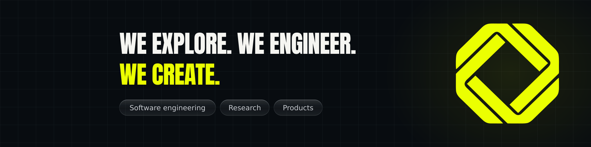

  

  <a href="https://softwaiz.com">Website</a> ·
  <a href="https://stories.softwaiz.com">Stories</a> ·
  <a href="https://github.com/orgs/Softwaiz/repositories?type=public">Open source</a> ·
  <a href="mailto:hello@softwaiz.com">Get in touch</a>

## Ideas deserve to become useful things.

We’re **Softwaiz**, a technology innovation company combining software engineering, research, and original products to solve real problems.

We build software around the way people and businesses actually work. We investigate the technology underneath it. And when we see a need worth addressing, we turn what we learn into a product.

### What we do

- **Engineering.** Custom software, web platforms, internal tools, and integrations that connect business operations.
- **Research.** Hands-on experiments with emerging technology, infrastructure, and the assumptions behind the tools we use. We share what we find in [Stories](https://stories.softwaiz.com).
- **Products.** Tools and services shaped by practical needs, from email and publishing to property discovery and knowledge curation.

### Explore our open source

| Project | What it does |
| --- | --- |
| [**GentleMail**](https://github.com/Softwaiz/gentlemail) | Multi-domain webmail, an email API, and signed webhooks running on your own Cloudflare account. [Explore GentleMail →](https://gentlemail.dev) |
| [**Whitewood**](https://github.com/Softwaiz/whitewood) | A publishing platform generator with visual page layouts and rich-text editing, built with RedwoodSDK for Cloudflare Workers. |
| [**recell**](https://github.com/Softwaiz/recell) | Adapts Vite + Workers build output for deployment on celld, including applications built with RedwoodSDK. |
| [**Reaction**](https://github.com/Softwaiz/reaction-game) | A multiplayer reaction game exploring synchronized timing with Durable Objects and WebSockets on self-hosted celld. |

### Beyond the repositories

Our product work also includes [**Linkits**](https://linkits.xyz), a home for organizing digital discoveries.

We’re also developing [**Kariboo**](https://kariboo.app), connecting property seekers in Benin with real estate agencies and opportunities, and exploring restaurant operations with **AlloResto**, an upcoming product.

### Follow the experiments

Our journal shares the questions, implementation details, and lessons behind the work. Start with [**What RedwoodSDK Actually Depends On**](https://stories.softwaiz.com/redwoodsdk-celld), the investigation behind recell and our self-hosted experiments.

[**Read Softwaiz Stories →**](https://stories.softwaiz.com)

### Build with us

Try a project, report a reproducible issue, or propose an improvement in its repository. For a business challenge, a product idea, or a potential collaboration, write to [**hello@softwaiz.com**](mailto:hello@softwaiz.com).
